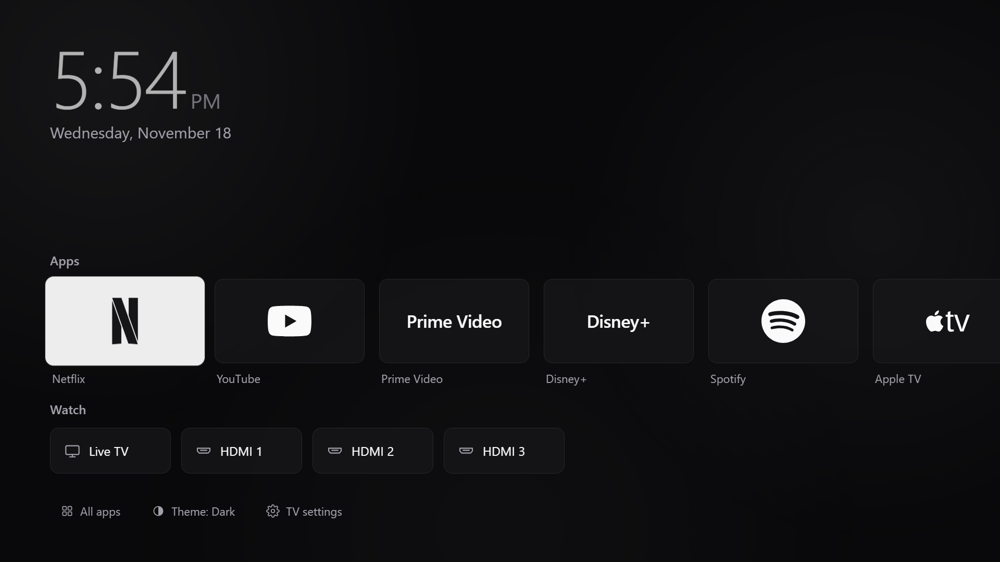

# Homeboard

A clean, modern home screen for LG webOS TVs. Big clock, live weather, your apps as large tiles,
quick access to Live TV and HDMI inputs, a full app drawer, dark / light / auto themes, slow drifting
background light, and an ambient mode that fades to clock + wallpaper when nobody is pressing buttons.



Plain HTML, CSS and JavaScript. No build step, no dependencies, no account, no tracking.
Runs on LG TVs with **webOS 4 or newer (2018 and later)**. Tested on webOS 4.

> Not affiliated with LG. App logos are trademarks of their owners and are only used to label the tiles.

## Contents

- [Features](#features)
- [Set it up with Claude Code (easiest)](#set-it-up-with-claude-code-easiest)
- [Set it up by hand](#set-it-up-by-hand)
- [Customize](#customize)
- [Updating](#updating)
- [Rooted TVs](#rooted-tvs)
- [Clean up LG's own home screen](#clean-up-lgs-own-home-screen)
- [Troubleshooting](#troubleshooting)
- [Credits](#credits)

## Features

- Remote friendly: arrows to move, OK to open, Back closes the drawer. The Magic Remote pointer works too.
- Weather from [Open-Meteo](https://open-meteo.com) (free, no API key). Your location is rounded to about 1 km.
- Your own photos as wallpapers with a slow crossfade and gentle zoom.
- Ambient mode after a few idle minutes. Any button wakes it.
- Dark, light or auto theme, switchable from the launcher.
- Monochrome logos that follow the theme. Apps without a logo get a clean typeset name.
- Everything is set in one file, `config.js`.

## Set it up with Claude Code (easiest)

This repo ships a Claude skill that walks you through the whole install and does the PC side for you.

1. Install [Claude Code](https://claude.com/claude-code).
2. Clone this repo and open Claude Code inside it:
   ```bash
   git clone https://github.com/Shaku-Med/lg-tv-launcher.git
   cd lg-tv-launcher
   claude
   ```
3. Say: **"install the launcher on my LG TV"**.

Claude picks up the skill in `.claude/skills/lg-tv-launcher/`, checks your PC, installs LG's CLI (it asks first),
tells you what to press on the TV, and packages + installs the app. You only type your TV's passphrase yourself.

Want the skill available in every project? Copy the folder to your personal skills:

```bash
cp -r .claude/skills/lg-tv-launcher ~/.claude/skills/
```

## Set it up by hand

### What you need

- An LG TV with webOS 4+ on the same network as your computer.
- A computer with [Node.js](https://nodejs.org) 20 or newer.
- A free LG developer account.

### 1. Turn on Developer Mode on the TV

1. Create a free account at [webostv.developer.lge.com](https://webostv.developer.lge.com) (Sign In → Sign Up).
   Use **email + password**, not "Login with Google": the TV only accepts an email and password.
2. On the TV, open the **LG Content Store**, search **Developer Mode**, install it.
3. Open **Developer Mode**, sign in with that email and password.
4. Turn **Dev Mode Status** on. The TV restarts.
5. Open **Developer Mode** again and turn **Key Server** on.
6. Note the **IP address** and the **passphrase** on that screen. Don't share the passphrase.

### 2. Install LG's CLI on your computer

```bash
npm install -g @webos-tools/cli
```

### 3. Connect your computer to the TV

Replace the IP with the one your TV shows:

```bash
ares-setup-device --add tv --info "{'host':'192.168.1.50','port':'9922','username':'prisoner','default':true}"
```

```bash
ares-novacom --device tv --getkey
```

Type the passphrase from the TV when asked. Check the connection:

```bash
ares-device --device tv --system-info
```

### 4. Package, install, open

From the folder that **contains** this repo folder:

```bash
ares-package lg-tv-launcher -o lg-tv-launcher-dist -e README.md -e docs -e .claude -e LICENSE -e .gitignore -e .git
```

```bash
ares-install --device tv lg-tv-launcher-dist/dev.homeboard.launcher_1.0.0_all.ipk
```

```bash
ares-launch --device tv dev.homeboard.launcher
```

It shows up as **Home** in your app bar. Move it to the front so it's one click away.

### 5. Keep it alive

Developer Mode apps stop working when the Dev Mode session runs out. The **Remain Session** timer is shown in
the Developer Mode app; press **Extend** before it reaches zero.

## Customize

Everything lives in [`config.js`](config.js):

| Setting | What it does |
| --- | --- |
| `weather.city`, `latitude`, `longitude` | Your city for weather. Leave `null` to hide it. Right click a spot on Google Maps to copy coordinates. |
| `weather.units` | `"fahrenheit"` or `"celsius"` |
| `clock24h` | `true` for a 24 hour clock |
| `motion` | `false` turns off all animation |
| `theme` | `"dark"`, `"light"` or `"auto"` (light from 7:00 to 19:00) |
| `ambientMinutes` | Idle minutes before ambient mode. `0` turns it off. |
| `wallpapers` | File names of photos you put in `wallpapers/` (1920x1080 JPG works best) |
| `apps` | Your main row: `{ id, title, icon }` |
| `inputs` | The Watch row: Live TV and HDMI |

### App ids

| App | id |
| --- | --- |
| Netflix | `netflix` |
| YouTube | `youtube.leanback.v4` |
| Prime Video | `amazon` |
| Disney+ | `com.disney.disneyplus-prod` |
| Spotify | `spotify-beehive` |
| Apple TV | `com.apple.appletv` |
| Plex | `cdp-30` |
| Web browser | `com.webos.app.browser` |
| Live TV | `com.webos.app.livetv` |
| HDMI 1 to 4 | `com.webos.app.hdmi1` ... `com.webos.app.hdmi4` |

Apps the TV doesn't have just fail to open with a short message, so it's safe to experiment.

### Icons

`icon` is the name of an SVG in [`icons/`](icons) without `.svg`. Any single color SVG works; the launcher
recolors it to match the theme. [Simple Icons](https://simpleicons.org) has most brands:

```bash
curl -o icons/plex.svg https://cdn.jsdelivr.net/npm/simple-icons@16.38.0/icons/plex.svg
```

Then add `icon: "plex"` to that app in `config.js`. No icon means the app's name is shown on the tile.

## Updating

After changing `config.js`, icons or wallpapers, run the three commands from step 4 again.

## Rooted TVs

If your TV can be rooted (check [cani.rootmy.tv](https://cani.rootmy.tv)) and you've installed the
[Homebrew Channel](https://www.webosbrew.org):

- Install the same `.ipk` through Homebrew Channel. It never expires.
- Install **LG Input Hook** from Homebrew Channel and point a remote button at
  `luna-send -n 1 luna://com.webos.applicationManager/launch '{"id":"dev.homeboard.launcher"}'`.
  Remap **Home** itself and this becomes your real home screen. Try a spare button first.

An official LG firmware update removes root, so turn off automatic updates on a rooted TV.

## Clean up LG's own home screen

Menu names vary a little between webOS versions. Look under **Settings → General → System → Additional Settings**:

- **Home Settings**: turn off *Home Auto Launch*, *Home Promotion* and *Content Recommendation*.
- **User Agreements**: turn off advertising and viewing information.
- **Quick Start+**: on, so the TV wakes up fast.

## Troubleshooting

**`No matched device <name> : tv`**: the device wasn't saved. Run `ares-setup-device --list`; if `tv` is missing,
run the `--add` command again in a normal terminal.

**`--getkey` fails**: Key Server must be ON in the Developer Mode app, and the TV and computer must be on the same network.

**Apps don't open**: check the id in `config.js`. On webOS 27+ the app needs the `application.launcher`
permission, which is already declared in `appinfo.json`.

**Why bundled icons instead of the TV's own?** LG blocks sideloaded apps from listing installed apps
(`listLaunchPoints` is denied), and Developer Mode apps can't read other apps' files. On a rooted TV the
launcher uses the TV's real icons automatically when it's allowed to.

**Debugging on the TV**: `ares-inspect --device tv --app dev.homeboard.launcher --open` opens DevTools for the running launcher.

**Preview on your computer**: `python -m http.server 8130` in this folder, then open `http://localhost:8130`.
Opening apps only works on the TV.

## Credits

- Logos: [Simple Icons](https://simpleicons.org) (CC0). Trademarks belong to their owners.
- Weather: [Open-Meteo](https://open-meteo.com).
- Rooting and homebrew: the [webOS Homebrew](https://www.webosbrew.org) community.

MIT licensed. See [LICENSE](LICENSE).
